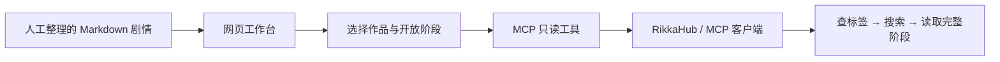

<div align="center">

# Novel Memory MCP

### 让 AI 接上你的故事，不必每次重讲过去。

为 **RikkaHub · 长篇小说 · 长期角色扮演** 准备的自托管记忆库。  
把整理好的历史保存在 Markdown 中，由你决定开放范围，让 AI 按需查阅完整剧情。

[](https://github.com/syydmtl/novel-memory-mcp/actions/workflows/ci.yml)
[](pyproject.toml)
[](LICENSE)

**中文** · [English](README.en.md) · [完整使用指南](docs/QUICKSTART.md) · [RikkaHub 接入](#3-连接-rikkahub)

</div>

---

人物曾经许下什么约定？谁知道那个秘密？这段关系为什么走到今天？

故事越长，这些细节越难靠一次对话保留下来。Novel Memory MCP 让你把关键历史整理成可查阅的阶段记录，在继续创作时找回相关内容。

**你维护故事，网页管理资料，AI 通过 MCP 查阅所需历史。**

## 适合怎样的故事？

- **长期 RP**：接续人物经历、关系变化、约定和未解决的剧情线。
- **长篇小说**：回查前文事件、人物动机与设定，辅助续写和修订。
- **多世界观创作**：分别保存不同作品的资料，按当前故事切换开放范围。
- **RikkaHub 用户**：用现有 MCP 连接能力，为对话增加可检索的历史资料。

## 用起来是什么样？



例如，你问：“查一下角色甲和角色乙之前约定过什么。”客户端中的 AI 可以先查看阶段标签，再搜索相关人物和事件，最后读取对应的完整历史阶段。

仓库附带两个通用虚构示例：“河港修桥”和“修复灯塔”。安装后就能试用，随后再创建自己的故事。

## 有哪些特点？

| 特点 | 对创作有什么帮助 |
| --- | --- |
| **完整阶段记忆** | 每个文件保存一段连贯历史，便于保留前因后果、关键对话和关系发展 |
| **先索引，后正文** | 搜索只返回 ID、时间与标题，确认后再读取完整阶段 |
| **由你控制开放范围** | 在网页中勾选当前允许 AI 查阅的阶段 |
| **多记忆库工作台** | 新建作品、编辑阶段、预览 Markdown、导入文件、筛选标签 |
| **AI 接口只读** | 模型通过 MCP 检索和读取；正文由人工编辑维护 |
| **资料掌握在自己手中** | 正文是普通 UTF-8 Markdown，易于查看、备份和迁移 |
| **轻量自托管** | Python + SQLite，无需配置 Embedding 或单独的向量数据库 |
| **两种 MCP 传输方式** | 支持 Streamable HTTP 与 STDIO |

服务不会自动总结、重写或拆分正文，也不会在普通聊天中自动加载全部历史。AI 的检索效果仍取决于记忆内容、标签质量和客户端是否调用工具。

## v0.1.1 更新

这次更新重点是保护已整理好的内容：不同中文文件名可分别导入，重复导入会提示冲突；编辑和删除前会保留历史备份，多个页面同时编辑时会检查版本，避免旧页面覆盖新内容。管理密码现在支持中文，挂载配置损坏时会停止开放资料并提示修复。

网页会分别显示待保存的勾选和实际已挂载范围。已有用户更新代码和依赖后，请重启两个服务并刷新页面；原有 Markdown、密码和挂载配置可以继续使用。详见 [更新日志](CHANGELOG.md) 和 [升级说明](docs/QUICKSTART.md#升级已有安装)。

## 快速开始

需要 **Python 3.10+**，首次安装依赖需要联网。可以克隆仓库，或从 [Releases](https://github.com/syydmtl/novel-memory-mcp/releases) 下载源码包。

```bash
git clone https://github.com/syydmtl/novel-memory-mcp.git
cd novel-memory-mcp
```

### 1. 安装并初始化

**Windows：**

```powershell
python -m venv .venv
.venv\Scripts\python.exe -m pip install -e "." -c security-constraints.txt
.venv\Scripts\python.exe run.py setup
.venv\Scripts\python.exe run.py check
```

**macOS / Linux：**

```bash
python3 -m venv .venv
.venv/bin/python -m pip install -e "." -c security-constraints.txt
.venv/bin/python run.py setup
.venv/bin/python run.py check
```

初始化会生成本机 `.env`，其中有两套独立随机密码：

- `NOVEL_MEMORY_ADMIN_TOKEN`：管理网页登录密码。
- `NOVEL_MEMORY_TOKEN`：MCP 客户端连接密码。

初始化还会开放两个演示阶段；重复执行不会覆盖已有 `.env`。

### 2. 启动网页和 MCP

Windows 在**两个终端**分别运行：

```powershell
.venv\Scripts\python.exe run.py admin
```

```powershell
.venv\Scripts\python.exe run.py mcp
```

macOS / Linux 将 Python 路径换成 `.venv/bin/python`，参数保持一致。

浏览器打开 **http://127.0.0.1:8767/**，输入管理密码。你可以在这里新建作品、导入历史阶段、勾选阶段并点击“保存挂载给 AI”。

### 3. 连接 RikkaHub

在 [RikkaHub](https://github.com/rikkahub/rikkahub) 中添加 MCP 服务：

| 项目 | 填写内容 |
| --- | --- |
| 传输方式 | Streamable HTTP |
| 服务地址 | `http://127.0.0.1:8766/mcp` |
| 请求头 | `Authorization: Bearer <NOVEL_MEMORY_TOKEN 的值>` |

**手机连接电脑时：** `127.0.0.1` 指的是手机自己，需要换成运行服务那台电脑的可访问地址，并配置监听地址、准确的 Host/Origin 允许列表和网络访问规则。远程保密连接请使用 HTTPS 或可信私网。详见 [配置指南](docs/QUICKSTART.md#配置与运行数据)。

可以先试一句：

> 请先查看历史阶段标签，再搜索灯塔，读取相关阶段，告诉我三人约定了什么信号。

这个示例查询对应仓库自带的通用虚构故事。

## AI 可以使用哪些工具？

| 工具 | 返回内容 |
| --- | --- |
| `list_memory_tags` | 阶段 ID、时间范围、标题、标签 |
| `search_memory` | 关键词匹配的阶段 ID、时间范围和标题 |
| `get_memory` | 一个指定阶段的完整正文 |
| `get_memories` | 最多两个指定阶段的完整正文 |

推荐顺序是 **看标签 → 搜索 → 读取所需阶段**。已知 ID 时可以直接读取。完整阶段本身仍会占用对应的模型上下文。

## 怎样整理自己的历史？

一份 Markdown 对应一个历史阶段，格式如下：

```markdown
---
id: my_stage_01
date_range: 故事第1天—第3天
title: 两位旅人第一次合作
tags: 角色甲, 角色乙, 河港, 约定
---

在这里填写你人工整理的历史经过、关键对话、关系变化和未完成的约定。
```

在网页中可以直接新增或导入 `.md` 文件。检索标签适合放人物、地点、别名和事件关键词。更多格式细节见 [记忆文件说明](libraries/README.md)。

## 常见问题

**会自动把聊天写进记忆吗？**  
当前需要人工整理和保存。MCP 接口只读，网页管理可以编辑内容。

**能同时向不同客户端开放不同故事吗？**  
当前是一套服务共享一个活动范围，一次选择一个作品及其中的阶段。需要独立范围时可运行独立实例。

**能控制 AI 看见哪些阶段吗？**  
设置活动记忆库后，列标签、搜索和正文读取都会限制在勾选范围内。保存空选择后，该库没有阶段可供 MCP 读取。

**资料会发给模型服务商吗？**  
本服务在本地读取和检索；MCP 客户端将结果交给云端模型时，相应正文会提供给该模型服务商。

**自己的小说会被 Git 提交吗？**  
新增的个人记忆库、后备目录正文、`.env` 和运行状态默认被 `.gitignore` 忽略。仓库中已跟踪的演示文件仍会记录修改，请把真实作品放进自己新建的记忆库。手动压缩分享时也请检查内容。

## 文档与参与

- [完整安装、STDIO 接入与配置说明](docs/QUICKSTART.md)
- [记忆文件格式](libraries/README.md)
- [安全与隐私](SECURITY.md)
- [贡献指南](CONTRIBUTING.md)
- [提交问题或建议](https://github.com/syydmtl/novel-memory-mcp/issues)

欢迎分享使用体验、改进文档或提交修复。报告问题时请用虚构样例复现，并隐藏密码和私人剧情。如果它帮你接上了一段故事，也欢迎点个 Star，让更多 RikkaHub 和创作用户找到它。

## License

[MIT](LICENSE)。
